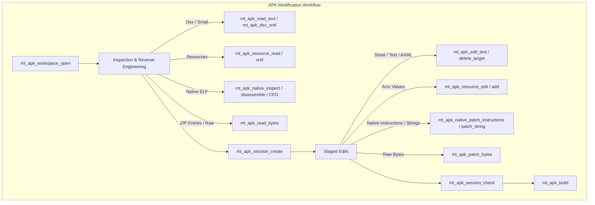
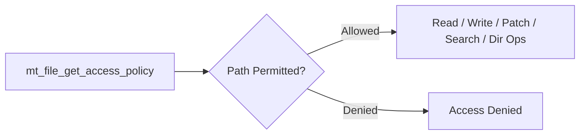

# MT Manager MCP — Available Tools Reference

> [!NOTE]
> **MT Manager MCP Server** provides 57 tools split into three core engines:
> 1. **APK Engine (`mt_apk_*`)** (30 tools): Inspection, Dex/Smali analysis, resource handling, native ELF reverse engineering, in-place binary/text patching, session staging, and APK building.
> 2. **File System Engine (`mt_file_*`)** (20 tools): Sandboxed, policy-governed local file I/O, regex searching, streaming reads/writes, byte patching, and directory tree management.
> 3. **ZIP Engine (`mt_zip_*`)** (7 tools): Archive integrity verification, entry stream inspection, selective extraction, archive creation, and in-place updates.

---

## Architecture & Workflow Overview

---

## 1. APK Workspace & Lifecycle Management

| Tool | Purpose | Key Parameters & Guidelines |
| :--- | :--- | :--- |
| **`mt_apk_workspace_open`** | **First tool to call**. Opens an APK into an immutable, read-only workspace. | `path`: `"mt://current-apk"`, `"mt://workspace/<workspaceId>"`, or Home-relative/absolute path. `temporary`: `true` for one-time fast verification; `false` to persist for long-term multi-session analysis. |
| **`mt_apk_list_available_apks`** | Lists discoverable APK targets that can be opened. | `prefix`: optional filter string. `limit`: default 50. Use `mt_apk_continue` for remaining pages. |
| **`mt_apk_workspace_list`** | Lists saved non-temporary APK workspaces that can be reopened. | Sorted by `lastAccessedAt` descending. Use `data.items[].path` with `temporary=false` in `mt_apk_workspace_open`. |
| **`mt_apk_workspace_delete`** | Permanently deletes an APK workspace and all associated edit sessions. | Mandatory cleanup for temporary workspaces (`temporary=true`). Avoid deleting non-temporary workspaces without explicit intent. |
| **`mt_apk_read_signature`** | Reads full signing certificate metadata for the original base APK. | Reports digest hashes, X.509 subject, issuer, validity period, and signing schemes (v1, v2, v3). |

---

## 2. APK Inspection, Discovery & Navigation

| Tool | Purpose | Key Parameters & Guidelines |
| :--- | :--- | :--- |
| **`mt_apk_list`** | Pages through items in an opened APK: ZIP file entries, Dex classes, or resource table entries. | `view`: `"zip_entries"`, `"dex_classes"`, or `"resource_entries"`. `prefix`: name filter. `limit`: default 200. Follow `nextActions` for pagination. |
| **`mt_apk_search`** | Global search across entire APK when exact target is unknown. | `target`: `"overview"`, `"smali"`, `"native_symbols"`, `"native_strings"`, or `"resource_table_file_paths"`. First call recommendation: `target="overview"`, `queryType="literal"`, `caseSensitive=false`, `matchMode="contains"`, `prefix=""`. Native hit offsets provide direct address contexts for xrefs. |
| **`mt_apk_continue`** | Universal pagination continuation tool. | Continues cursor-based pagination for `mt_apk_search`, `mt_apk_native_list_items`, `mt_apk_native_xref`, and `mt_apk_list_available_apks`. Pass opaque `nextCursor` unchanged. |

---

## 3. Dex & Smali Reverse Engineering

| Tool | Purpose | Key Parameters & Guidelines |
| :--- | :--- | :--- |
| **`mt_apk_read_text`** | Decodes and reads text representation from an APK locator string. | Supports `zip_entry:`, `axml:`, `dex_class:`, `dex_method:`, and `dex_field:`. Normalized to `LF`. Ordinary zip text decoded up to 10 MiB. Returns `targetVersion` needed for `mt_apk_edit_text`. |
| **`mt_apk_dex_read_class_outline`** | Reads the class outline (fields, methods, superclass, interfaces, flags) of a Dex class. | `locator`: Exact descriptor format (e.g. `dex_class:Lcom/example/MainActivity;`). Use `mt_apk_list` with `view="dex_classes"` to locate class descriptors first. |
| **`mt_apk_dex_xref`** | Finds incoming bytecode cross-references for Dex methods, fields, or classes. | `methodResolution`: `"dispatch"` (default for virtual calls), `"slot"` (hierarchy overrides), or `"exact"` (strict reference equality). Use `"not_applicable"` for fields/classes. |

---

## 4. Android Resource Handling (`resources.arsc` & AXML)

| Tool | Purpose | Key Parameters & Guidelines |
| :--- | :--- | :--- |
| **`mt_apk_resource_read`** | Batch reads compiled resource table entries by exact resource ID and configuration. | `reads[]`: 1..200 items with `resource:0x...` locator and variant (e.g. `"default"`, `"port"`). Returns complete editable `valueXml`. Budget guidelines: `maxValueChars=4096`, `maxValueXmlChars=32768`. |
| **`mt_apk_resource_xref`** | Finds cross-references pointing to a specific resource ID. | `scopes`: `["dex", "axml", "resource_table"]`. Reports exact resource ID usages across compiled bytecode, binary XML layouts, and resource values. |
| **`mt_apk_resource_edit`** | Modifies existing `resources.arsc` values in an edit session. | `edits[]`: 1..200 items containing `locator`, `variant`, `targetVersion`, and complete root `valueXml` obtained from `mt_apk_resource_read`. |
| **`mt_apk_resource_add`** | Adds brand new resource IDs or new configuration variants to an existing package. | `kind="resource"` to allocate a new ID; `kind="variant"` to add a configuration value to an existing ID. All edits are atomic. |

---

## 5. Native ELF Reverse Engineering (`.so` Binaries)

| Tool | Purpose | Key Parameters & Guidelines |
| :--- | :--- | :--- |
| **`mt_apk_native_inspect`** | **Entry point for native analysis**. High-level summary of an ELF shared object. | Provides architecture, endianness, bit width, machine type, section summaries, and unfiltered item counts for symbols, dynamic symbols, relocations, and init/fini arrays. |
| **`mt_apk_native_list_items`** | Paginates through detailed ELF item tables. | `itemKind`: `"symbols"`, `"dynamic_symbols"`, `"relocations"`, `"init_array"`, `"fini_array"`, `"segments"`, `"sections"`, `"string_table"`. `namePrefix`: filter prefix. |
| **`mt_apk_native_map_address`** | Maps virtual addresses (VA) to file offsets and vice-versa within an `.so` entry. | Checks `isLoaded` and `isExecutable`. Returns enclosing function symbol context to guide disassembly and CFG generation. |
| **`mt_apk_native_xref`** | Searches static direct references (calls, jumps, data pointers) to an ELF address. | `scanKind`: `"both"`, `"code"`, or `"data"`. `referenceKinds`: `["call", "jump", "data"]`. Supports ARM, Thumb, ARM64, x86, and x86_64. |
| **`mt_apk_native_disassemble`** | Disassembles an instruction window from executable ELF memory. | Formats output as `0x<hex-address>: <hex-bytes> <assembly>`. Continuous disassembly follows `mt_apk_native_disassemble` directly (not `mt_apk_continue`). |
| **`mt_apk_native_analyze_control_flow`** | Constructs a bounded static Control-Flow Graph (CFG) of an ELF function. | `outputMode`: `"summary"` for high-level structure (complexity, loop counts); `"full"` for complete basic block vertices and directed edges. |

---

## 6. APK Modification, Patching & Session Management

> [!IMPORTANT]
> The base workspace opened by `mt_apk_workspace_open` is strictly immutable. To perform edits, you must first create an isolated edit session using `mt_apk_session_create`.

| Tool | Purpose | Key Parameters & Guidelines |
| :--- | :--- | :--- |
| **`mt_apk_session_create`** | Creates an isolated, copy-on-write APK edit session from an immutable workspace. | Returns `editSessionId`. All modifications and session-aware reads accept this session token. |
| **`mt_apk_session_check`** | Validates session changes before compiling. | `runBuildChecks=false`: reports dirty list and recorded errors. `runBuildChecks=true`: prepares Smali/AXML, checks entry readability, and runs Dex merge checks. |
| **`mt_apk_edit_text`** | Edits text, Smali code, or binary XML in an edit session. | `edits[]`: modes include `replace_match`, `insert_before_match`, `insert_after_match`, and `write_target`. Atomic application: requires exact matching `targetVersion` from `mt_apk_read_text`. |
| **`mt_apk_delete_target`** | Instantly removes an entire target without prior reads. | Accepts `dex_class:`, `dex_method:`, `axml:`, and `zip_entry:`. Bypasses stale version checks. |
| **`mt_apk_copy_entry`** | Copies an uncompressed raw ZIP entry between an APK session and local disk. | Modes: `workspace_to_local` or `local_to_edit_session`. Preserves source raw content. |
| **`mt_apk_patch_bytes`** | Raw byte replacement inside any ordinary ZIP entry. | `patches[]`: 1..200 non-overlapping ranges with `byteOffset`, `expectedHex`, and `replacementHex` of identical length. Fallback tool when semantic editors do not apply. |
| **`mt_apk_native_patch_instructions`** | Assembles and patches executable instructions into an ELF shared library. | `addressKind`: `"virtual"` or `"file_offset"`. `replacementAssembly`: assembly instructions string. `expectedHex`: safety guard against stale disassembly. Handles instruction alignment and optional NOP padding. |
| **`mt_apk_native_patch_string`** | In-place UTF-8 string modification in an ELF shared library. | `paddingMode`: controls NUL termination, space padding, or exact-length matching. Growth capped to existing padding bounds. |
| **`mt_apk_build`** | Compiles the staged session into a finished Android APK file. | `sign`: `true` to sign using MT MCP keystore profile; `false` for unsigned output. `outputName`: destination file name or absolute path. `overwrite`: permits replacing existing files. |

---

## 7. Raw Binary & Byte Inspection

| Tool | Purpose | Key Parameters & Guidelines |
| :--- | :--- | :--- |
| **`mt_apk_read_bytes`** | Reads uncompressed raw hex bytes from an APK ZIP entry. | `locator`: `zip_entry:...`. Outputs uppercase contiguous hex string and byte window length. Paginates via `nextActions`. |

---

## 8. Local File System Management (`mt_file_*`)

The MT File Engine executes under an explicit access control policy configured inside MT Manager settings.

### Access Policy & Inspection
| Tool | Purpose | Description |
| :--- | :--- | :--- |
| **`mt_file_get_access_policy`** | Inspect current security permissions. | Returns MT Home directory path, allowed root rules, read/write grants, and blacklisted system paths. |
| **`mt_file_stat`** | File/directory metadata. | Returns absolute path, entry type, byte size, modified timestamp, and `targetVersion`. |
| **`mt_file_list`** | Compact directory listing. | Lists directory children with pagination support. Supports `path=""` for Home folder. |

### Text & Binary Reading
| Tool | Purpose | Description |
| :--- | :--- | :--- |
| **`mt_file_read_text`** | Strict line-ending-preserving text reading. | Preserves LF, CRLF, and CR verbatim. Detects or forces character encodings. Returns pagination cursor and `targetVersion`. |
| **`mt_file_read_bytes`** | Raw hexadecimal byte reading. | Paged reads of up to 64 KiB per call. Returns uppercase hex and whole-file `targetVersion`. |

### Writing, Patching & Editing
| Tool | Purpose | Description |
| :--- | :--- | :--- |
| **`mt_file_edit_text`** | Transactional text file editing. | Atomic in-place text replacement/insertion with strict charset preserving. Supports creating new files via `targetVersion="missing"`. |
| **`mt_file_replace_text`** | Whole-file regex or literal search-and-replace. | Evaluates matches across entire content without re-evaluating replaced regions. Preserves BOM and newline styles. |
| **`mt_file_append_text`** | Strict text appending at EOF. | Preserves physical BOM and encoding. Trailing CR followed by LF correctly forms CRLF. |
| **`mt_file_write_bytes`** | Create or overwrite file with raw hex bytes. | Writes up to 1 MiB raw bytes. Requires `targetVersion="missing"` or current version match. |
| **`mt_file_patch_bytes`** | Multi-point equal-length raw byte patching. | Applies 1..200 in-place patches with `expectedHex` verification before applying. |
| **`mt_file_append_bytes`** | Append raw hex bytes directly at EOF. | Appends binary bytes without delimiters, BOM, or padding. |
| **`mt_file_truncate_bytes`** | Truncates file to specified byte size. | Keeps `[0, size)` and discards remainder. `size=0` clears file. |

### Search & File Management
| Tool | Purpose | Description |
| :--- | :--- | :--- |
| **`mt_file_search`** | Recursive file finding with name, size, time, and text content filters. | Streaming sliding-window content search with regular expressions and pattern matching across arbitrary folder trees. |
| **`mt_file_search_text`** | Line-by-line grep on a single text file. | Returns line numbers and contextual snippets matching regex or literal queries. |
| **`mt_file_copy`** | Raw byte local file copying. | Preserves file mode, ownership, and timestamps. Supports large files. |
| **`mt_file_move`** | Atomic move or rename. | Operates on regular files and directories. Requires non-existent destination when moving directories. |
| **`mt_file_delete`** | Permanent single file deletion. | Immediate deletion without recycle bin. Rejects directories and symbolic links. |
| **`mt_file_create_directory`** | Directory creation with parent creation. | Equivalent to `mkdir -p`. Idempotent for existing directories. |
| **`mt_file_delete_directory`** | Directory removal. | `recursive=false` for empty directories; `recursive=true` for recursive tree deletion. |

---

## 9. ZIP Archive Management (`mt_zip_*`)

| Tool | Purpose | Key Parameters & Guidelines |
| :--- | :--- | :--- |
| **`mt_zip_list`** | Lists all entries and virtual directories inside a ZIP archive. | Depth-first traversal. Preserves leading/trailing slashes. Paginates via continuation tokens. |
| **`mt_zip_test`** | Validates structural integrity and entry checksums (CRC32/AES). | Reads every non-directory entry to detect corruption or password failures. |
| **`mt_zip_read_text`** | Previews text entry content directly from archive. | Preserves line endings. Useful for quick inspection before full extraction. |
| **`mt_zip_read_bytes`** | Previews raw uncompressed hexadecimal bytes of a ZIP entry. | Offsets point into decompressed entry data. |
| **`mt_zip_extract`** | Extracts selected files or entire directories to local disk. | Validates extraction paths against directory traversal attacks (`../`). Creates destination directories automatically. |
| **`mt_zip_create`** | Builds a new ZIP file from local files or directories. | Explicit source-to-entry mapping. Supports optional AES-256 encryption via `password`. |
| **`mt_zip_update`** | In-place add, delete, or rename operations on an existing archive. | Modifies archive structure. New entries use Deflate; replacements preserve existing compression methods. |

---

## Quick Reference: Typical Task Workflows

### Scenario A: Modifying a Method in Smali
1. `mt_apk_workspace_open(path="mt://current-apk", temporary=false)` $\rightarrow$ get `workspaceId`.
2. `mt_apk_search(target="smali", query="checkLicense")` $\rightarrow$ find class/method locator.
3. `mt_apk_read_text(locator="dex_method:Lcom/app/Security;->checkLicense()Z")` $\rightarrow$ obtain Smali and `targetVersion`.
4. `mt_apk_session_create(workspaceId=...)` $\rightarrow$ get `editSessionId`.
5. `mt_apk_edit_text(...)` $\rightarrow$ replace opcode with `const/4 v0, 0x1 / return v0`.
6. `mt_apk_session_check(runBuildChecks=true)` $\rightarrow$ verify Dex compilation.
7. `mt_apk_build(sign=true)` $\rightarrow$ compile and sign final APK.

### Scenario B: Patching a Native Function in `.so`
1. `mt_apk_native_inspect(locator="zip_entry:lib/arm64-v8a/libnative.so")` $\rightarrow$ check ELF header & architecture.
2. `mt_apk_native_list_items(itemKind="dynamic_symbols", namePrefix="is_rooted")` $\rightarrow$ get virtual address `0x1A2B0`.
3. `mt_apk_session_create(workspaceId=...)` $\rightarrow$ get `editSessionId`.
4. `mt_apk_native_disassemble(address="0x1A2B0", maxBytes=16)` $\rightarrow$ get original instructions & machine bytes.
5. `mt_apk_native_patch_instructions(address="0x1A2B0", replacementAssembly="mov w0, #0\nret", expectedHex=...)`.
6. `mt_apk_build(sign=true)`.

### Scenario C: Modifying an App String in `resources.arsc`
1. `mt_apk_search(target="overview", query="Subscription Expired")` $\rightarrow$ get resource ID (e.g. `resource:0x7f100042`).
2. `mt_apk_session_create(workspaceId=...)` $\rightarrow$ get `editSessionId`.
3. `mt_apk_resource_read(reads=[{locator: "resource:0x7f100042", variant: "default"}])` $\rightarrow$ get `valueXml` & `targetVersion`.
4. `mt_apk_resource_edit(edits=[{locator: "resource:0x7f100042", variant: "default", targetVersion: ..., valueXml: "<string ...>Lifetime VIP</string>"}])`.
5. `mt_apk_build(sign=true)`.
